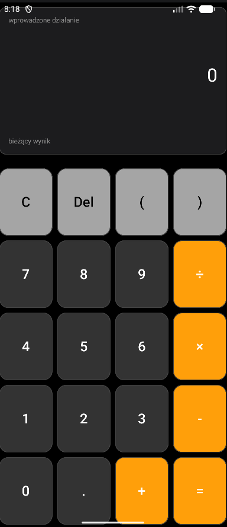
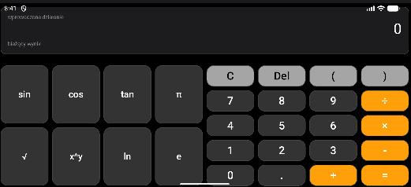
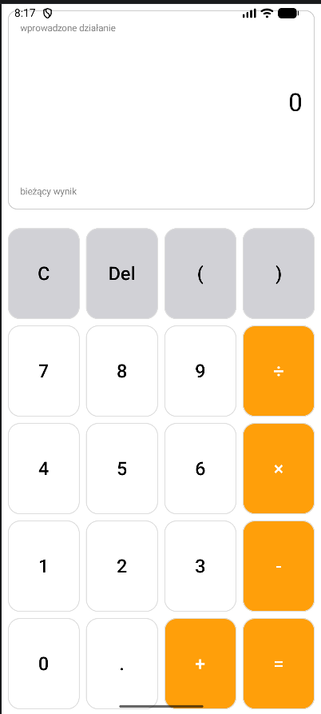
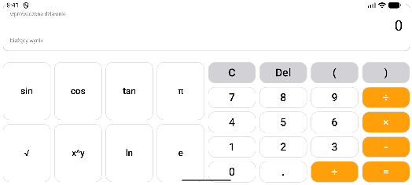
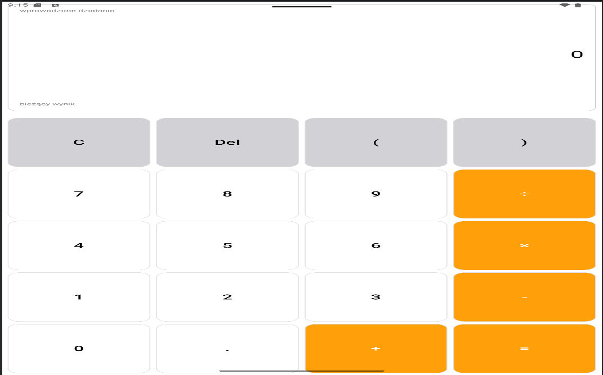
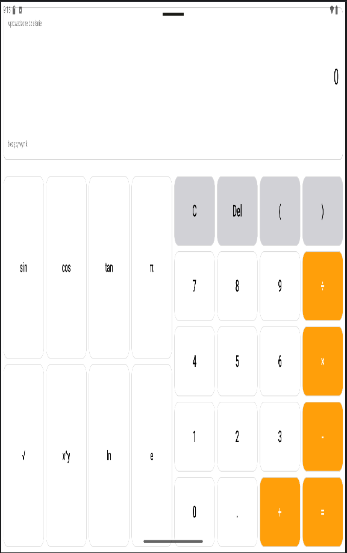

# Kalkulator Android - Jetpack Compose

Responsywny kalkulator matematyczny napisany w Kotlinie przy użyciu Jetpack Compose. Aplikacja automatycznie dostosowuje swój interfejs do orientacji ekranu oraz rodzaju urządzenia (telefon/tablet), oferując klasyczny układ w pionie oraz rozbudowany tryb naukowy w poziomie. Obliczenia wspierane są przez bibliotekę `exp4j`. Aplikacja w pełni obsługuje systemowy tryb jasny i ciemny.

## Zrzuty ekranu - Tryb Ciemny

### Telefon (Pion / Poziom)
Pionowy układ na telefonie oferuje standardową klawiaturę numeryczną z podstawowymi operacjami. Po obróceniu urządzenia interfejs dzieli się, ujawniając panel z funkcjami inżynieryjnymi.
| Telefon - Pion | Telefon - Poziom |
| :---: | :---: |
|  |  |

## Zrzuty ekranu - Tryb Jasny

### Telefon (Pion / Poziom)
Pełna obsługa jasnego motywu systemowego. Kolorystyka przycisków i tła płynnie dostosowuje się do preferencji użytkownika, zachowując przy tym wysoką czytelność.
| Telefon - Pion | Telefon - Poziom |
| :---: | :---: |
|  |  |

## Zrzuty ekranu - Tablet

### Skalowanie na większych ekranach (Pion / Poziom)
Dzięki użyciu modyfikatorów `weight()` w układach Jetpack Compose, interfejs kalkulatora płynnie skaluje się na ekranach tabletów, optymalnie wypełniając dostępną przestrzeń.
| Tablet - Pion | Tablet - Poziom |
| :---: | :---: |
|  |  |
[cite: 3, 4, 5, 6, 7, 8]

## Decyzje projektowe (UX/UI)

### Kolorystyka w stylu iPhone'a
W projekcie zastosowałem schemat kolorów inspirowany kalkulatorem z systemu iOS (pomarańczowe operatory, zróżnicowane odcienie szarości dla cyfr i funkcji). Wybrałem ten design z dwóch powodów:
1. **Doskonały kontrast:** Pomarańczowe akcenty świetnie odcinają się od reszty klawiatury, co przyspiesza odnajdywanie najważniejszych działań.
2. **Przyzwyczajenie:** Jako codzienny użytkownik iPhone'a, ten układ jest dla mnie najbardziej naturalny i intuicyjny.

### Dlaczego na wyświetlaczu pojawia się symbol `π`, a nie liczba?
Gdy użytkownik wpisuje działanie, na ekranie głównym kalkulatora widnieje symbol `π`, a nie jego rozwinięcie (np. `3.14159...`). Takie rozwiązanie sprawia, że wprowadzane równanie pozostaje krótkie, przejrzyste i przypomina naturalny zapis matematyczny znany ze szkoły. Dopiero "pod maską", w ułamku sekundy przed wykonaniem obliczeń, aplikacja tłumaczy ten symbol na ciąg znaków zrozumiały dla biblioteki matematycznej, zapewniając idealnie precyzyjny wynik bez zaśmiecania ekranu długimi ciągami cyfr.
